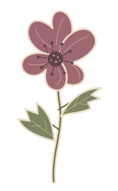
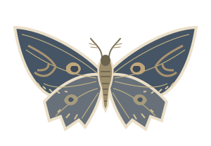
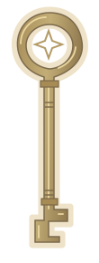
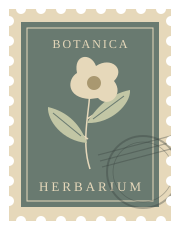
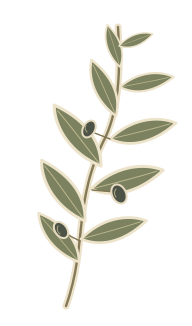
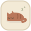
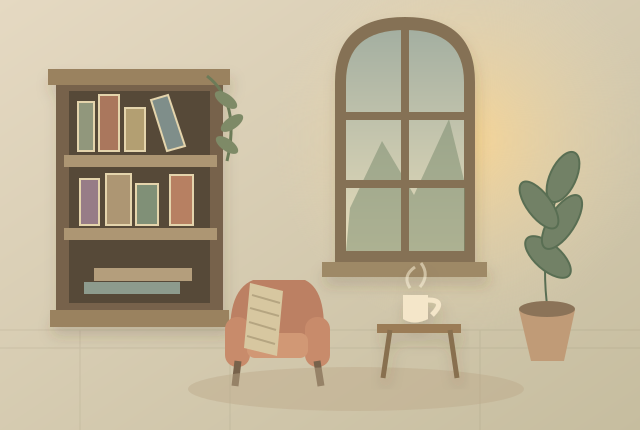

<div align="center">

&nbsp;&nbsp;&nbsp;&nbsp;&nbsp;&nbsp;&nbsp;&nbsp;

<br/>



<a href="#"></a>


**[✨ Возможности](#-возможности)** &nbsp;•&nbsp; **[🚀 Установка](#-установка)** &nbsp;•&nbsp; **[🖼️ Скриншоты](#-скриншоты)** &nbsp;•&nbsp; **[❓ Вопросы](#-вопросы)**

<br/>


<sub><i>Ваша комната историй: камин, ёлка, книжные шкафы и спящий кот</i></sub>

</div>

<br/>

##  Что это такое

**«Тихая глава»** — уютное настольное приложение для тех, кто любит читать не спеша. Это не сухой трекер прочитанного, а личный читательский уголок: книги стоят на полках в тёплой 3D-комнате, у каждой есть свой дневник-скрапбук, а за окном тихо идёт снег.

Никаких аккаунтов, подписок и облаков — всё живёт только на вашем компьютере.

<br/>

##  Возможности

<table>
<tr>
<td width="50%" valign="top">

 **3D-комната у камина**<br/>
<sub>Ваши книги стоят в настоящих шкафах. Наведите на корешок — книга выдвинется, кликните — откроется её дневник.</sub>

 **Личная библиотека**<br/>
<sub>Обложки, оценки с полузвёздами, поиск изданий в Open Library и список «Хочу прочитать».</sub>

 **Дневник-скрапбук**<br/>
<sub>Двухстраничные развороты: заметки, фото, наклейки, васи-скотч, рисование и разные виды бумаги.</sub>

 **Между строк**<br/>
<sub>Все любимые цитаты и мысли из книг собраны в одной красивой галерее.</sub>

</td>
<td width="50%" valign="top">

 **Спокойный прогресс**<br/>
<sub>Цель на месяц, прочитанные страницы и график — без давления и гонки за цифрами.</sub>

 **Карточки итогов**<br/>
<sub>Открытки 1080×1920 с итогами месяца или года — для телефона и соцсетей.</sub>

 **Звуки уюта**<br/>
<sub>Дождь за окном, треск поленьев и тихое ретро-радио прямо на столике в комнате.</sub>

 **Темы оформления**<br/>
<sub>Тёплый крем, тёмная академия и праздничная хвоя — под любое настроение.</sub>

</td>
</tr>
</table>

<br/>

##  Установка

> [!TIP]
> Готовой сборке не нужны ни Node.js, ни что-либо ещё — просто запустите `.exe`.

**1.** Откройте последнюю успешную сборку в [**GitHub Actions**](../../actions/workflows/windows.yml).

**2.** Скачайте артефакт **`Sanctuary-Windows-x64`** и распакуйте его.

**3.** Запустите `.exe` — приложение встретит вас стартовой полкой с примерами книг 📚

<details>
<summary><b>🛠️ Хочу собрать сам</b></summary>

<br/>

Нужны **Windows 10/11** и **Node.js 20+**.

```powershell
git clone https://github.com/GL1NoMe5/OwnLibrary.git
cd OwnLibrary
npm ci
npm run dev        # запуск в режиме разработки
npm run build:win  # установщик и portable-версия в dist/
```

</details>

<br/>

##  Скриншоты

<div align="center">


<sub><b>Дневник-скрапбук с фото, наклейками и заметками</b></sub>

<br/><br/>

<table>
<tr>
<td width="50%"><p align="center"><sub><b>Библиотека</b></sub></p></td>
<td width="50%"><p align="center"><sub><b>Тёмная академия</b></sub></p></td>
</tr>
<tr>
<td width="50%"><p align="center"><sub><b>Между строк</b></sub></p></td>
<td width="50%"><p align="center"><sub><b>Карточка итогов</b></sub></p></td>
</tr>
</table>

</div>

<br/>

##  Как это работает

<div align="center">

<table>
<tr>
<td align="center" width="25%"><br/><b>1. Добавьте книгу</b><br/><sub>вручную или через Open Library</sub></td>
<td align="center" width="25%"><br/><b>2. Поставьте на полку</b><br/><sub>она появится в 3D-комнате</sub></td>
<td align="center" width="25%"><br/><b>3. Ведите дневник</b><br/><sub>мысли, цитаты и коллажи</sub></td>
<td align="center" width="25%"><br/><b>4. Подведите итоги</b><br/><sub>красивая карточка месяца</sub></td>
</tr>
</table>

</div>

<br/>

##  Вопросы

<details>
<summary><b>Где хранятся мои книги и записи?</b></summary>
<br/>
Только на вашем компьютере — в папке <code>%APPDATA%\Cozy Reader's Sanctuary</code>. Никаких серверов и аккаунтов.
</details>

<details>
<summary><b>Как перенести библиотеку на другой компьютер?</b></summary>
<br/>
В «Настроении и настройках» сохраните резервную копию — вся библиотека вместе с обложками и фото упакуется в один <code>.zip</code>. На новом компьютере просто восстановите её оттуда же.
</details>

<details>
<summary><b>Нужен ли интернет?</b></summary>
<br/>
Нет. Интернет пригодится только для поиска изданий и обложек в Open Library — всё остальное работает офлайн.
</details>

<details>
<summary><b>Можно ли выключить звуки или анимации?</b></summary>
<br/>
Да — громкость, гирлянды, качество графики и режим снижения анимаций настраиваются в «Настроении и настройках».
</details>

<br/>

<div align="center">

<table>
<tr>
<td></td>
<td></td>
<td></td>
<td></td>
<td></td>
<td></td>
<td></td>
<td></td>
<td></td>
</tr>
</table>

<i>«Самые тихие вечера оставляют самые тёплые истории.»</i><br/>
<sub>⭐ Если «Тихая глава» сделала ваш вечер уютнее — поставьте звёздочку репозиторию!</sub>

</div>

<br/>

---

<div align="center">


<sub>Сделано с ❤️ для тех, кто любит книги, чай и долгие вечера.</sub><br/>
<sub><i>Electron · React · TypeScript · Three.js · SQLite &nbsp;·&nbsp; <a href="THIRD_PARTY_NOTICES.md">сторонние компоненты</a></i></sub>

<br/><br/>



</div>
