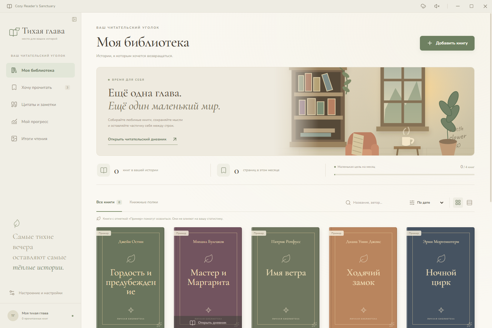
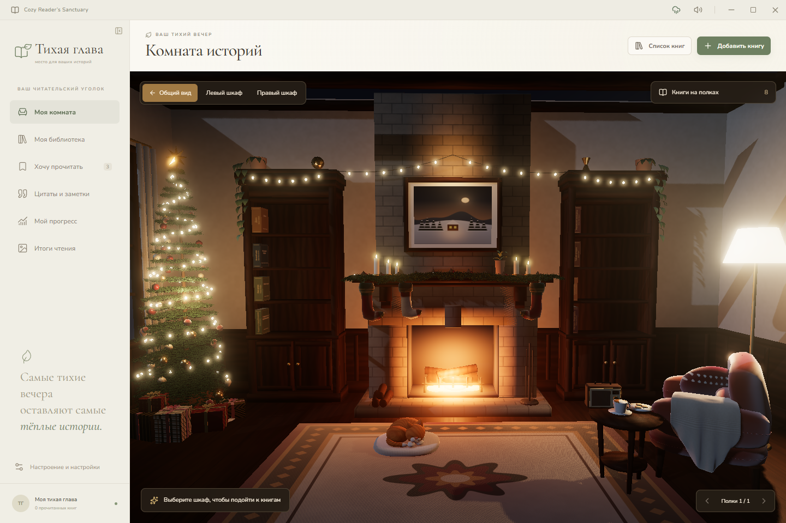
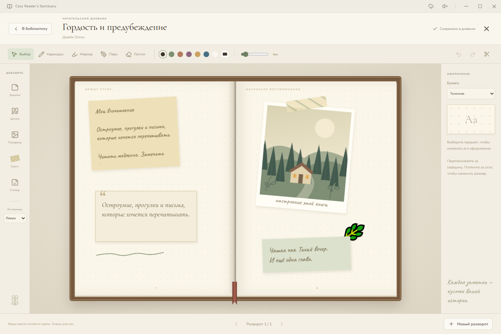

# Тихая глава · Cozy Reader’s Sanctuary

Самостоятельное приложение для Windows: личная библиотека, читательский дневник на двух страницах и красивые итоги чтения. Книги, записи и фотографии хранятся локально.



## Что умеет текущая версия

- Прочитанные книги и список желаний, поиск, оценки с шагом 0,5, дата завершения и любимые цитаты.
- Ручное добавление, поиск изданий в Open Library, загрузка собственных обложек. Онлайн-обложки копируются в библиотеку.
- Книжные полки с автоматическим размещением и дополнительными страницами для больших коллекций.
- Дневник: четыре бумаги, рисунки, полупрозрачный маркер, перо, ластик, undo/redo и автосохранение.
- Перемещаемые заметки, цитаты, полароиды, фотографии, стикеры и декоративный скотч. Изменение размера, поворот, шрифт и слои.
- Цель на месяц, статистика по завершённым книгам, галерея цитат и заметок.
- Три оформления карточек итогов за месяц или год; экспорт PNG 1080×1920.
- Настоящие записи дождя у окна и камина, плавное зацикливание и настройка громкости; уменьшение анимаций.
- Тихая lo-fi аранжировка Jingle Bells из радио на столе: клик ставит музыку на паузу и продолжает с того же места без уведомлений. Позиция сохраняется при переходах между экранами в текущем сеансе; общий переключатель звука выключает и радио.
- Резервные копии базы вместе с изображениями и восстановление из архива.

**Версия 1.2 — новогодняя комната:** ёлка, подарки, носки и гирлянды из праздничного пакета Argon, уточнённая объёмная хвоя и ткань, ночное освещение и локальные отражения. Нажмите «Моя комната» в меню. Наведение выдвигает настоящую книгу библиотеки, клик открывает дневник. «Найти на полке» приводит к нужному шкафу. Модели включены в EXE, Blender для запуска не нужен.



Камин, гирлянды, качество графики и уменьшение анимации управляются в настройках. Обычный список библиотеки доступен рядом; при недоступности WebGL можно продолжить в нём. Подробности и ограничения — в [описании комнаты](docs/ROOM.md).



## Запуск из исходников

Потребуются Windows x64, Node.js 24 и npm.

```powershell
npm ci
node node_modules/electron/install.js
npm run dev
```

Для запуска собранного EXE Node.js не нужен. Приложение работает без интернета; подключение используется при поиске книг и получении их обложек.

```powershell
npm run typecheck
npm test
npm run build
npm run test:e2e
npm run build:win
```

Установщик и portable появляются в `dist/`. Выпуск распространяется без цифровой подписи. Обновление выполняется вручную. Portable означает запуск без установки; база хранится в профиле пользователя, а для переноса на другой компьютер используется архив.

Автоматическая сборка Windows настроена в GitHub Actions. Готовые EXE доступны в артефактах успешного запуска workflow **Windows checks and application**.

## Работа с дневником

Откройте книгу нажатием на обложку или корешок. Выберите левую или правую страницу для новых предметов. В режиме выбора предметы можно перетаскивать, в том числе между страницами; выделенный предмет получает ручки размера и поворота. Для редактирования текста выберите заметку.

- `Ctrl+Z` / `Ctrl+Y` — отмена и повтор; `Ctrl+Shift+Z` также повторяет действие.
- `Ctrl+S` — немедленное сохранение.
- `Delete` — удаление выделенного предмета.
- `Escape` — снять выделение или закрыть дневник.

История действий действует в пределах открытого дневника. Ластик стирает рисунок, сохраняя бумагу и предметы. Очистка выбранной страницы также затрагивает только штрихи.

Автосохранение начинается через 500 мс после изменения. Статус «Сохранено» означает, что Main подтвердил запись на диск. Перед обычным закрытием приложение дожидается записи; при её ошибке окно остаётся открытым. Аварийное завершение может потерять изменения после последнего подтверждения.

## Данные

Основной каталог — `%APPDATA%\Cozy Reader's Sanctuary`:

- `sanctuary.sqlite` — база SQLite;
- `sanctuary.sqlite.bak` — предыдущая подтверждённая версия;
- `media/` — импортированные изображения;
- `.media-before-*` — изображения перед восстановлением архива.

Тесты используют отдельные временные каталоги. Для изолированного запуска можно задать `SANCTUARY_DATA_DIR`.

Один экземпляр приложения владеет базой. Записи сериализованы, файл заменяется после записи временной копии, при ошибке сохранения восстанавливается подтверждённое состояние в памяти. Повреждённая база не заменяется пустой: приложение предлагает восстановление предыдущей версии.

При первом запуске создаются восемь демонстрационных книг с оформленными разворотами и три книги в wishlist. Примеры не входят в личную статистику; их можно удалить в настройках. Они не создаются повторно после удаления.

Статистика использует дату завершения книги. Сумма страниц относится к законченным книгам и не является журналом ежедневных сессий. Неизвестные оценки исключены из среднего, неизвестное количество страниц не подменяется вымышленным.

## Устройство проекта

- `src/main` — база, IPC, изображения, Open Library, архивы и системные диалоги.
- `src/preload` — ограниченный типизированный мост `window.sanctuaryAPI`.
- `src/shared` — типы, валидация, расчёты статистики и размещения.
- `src/renderer` — интерфейс, история редактора, рисование, звук и PNG-композиция.
- `tests/unit` — сохранение, откат при отказе диска, история, конкурирующие изменения, статистика и размещение 1000 книг.
- `tests/e2e` — запуск Electron, создание книги, рисунок, дневник после перезапуска, PNG и резервный архив.
- `scripts` — воспроизводимые оригинальные иллюстрации и иконка.

Electron использует sandbox, context isolation и проверку источника IPC. Сетевой поиск выполняет Main; renderer не получает произвольный доступ к файловой системе. Изображения обслуживаются через ограниченный локальный протокол `sanctuary-media://`.

## Дальнейшее развитие

Интеграция праздничной комнаты завершена. Дальнейшие художественные варианты и замеры на физических GPU перечислены в [плане развития](docs/ROADMAP.md). Текущие исходники комнаты и кота сохранены в `artwork/codex-v03/source/`; пакет и повторный экспорт описаны в [README v03](artwork/codex-v03/README.md).

Сведения о внешних компонентах и шрифтах — в [THIRD_PARTY_NOTICES.md](THIRD_PARTY_NOTICES.md). Общая лицензия проекта владельцем пока не выбрана.
