# 📖 Тихая глава · Cozy Reader’s Sanctuary

<div align="center">

**Атмосферная библиотека, интерактивный читательский дневник и тёплая 3D-комната для тех, кто любит книги**

[О проекте](#-о-проекте) • [Возможности](#-главные-возможности) • [3D-комната](#1--уютная-3d-комната-историй) • [Дневник читателя](#3--двухстраничный-читательский-дневник) • [Скриншоты](#-галерея-интерфейса) • [Установка и запуск](#-установка-и-запуск) • [Хранение данных](#-данные-и-безопасность)

[](package.json)
[](#-установка-и-запуск)
[](https://www.electronjs.org/)
[](https://react.dev/)
[](https://threejs.org/)
[-8c5360.svg?style=for-the-badge>)](#-данные-и-безопасность)

---

</div>

<p align="center">
  
</p>

---

> _«Самые тихие вечера оставляют самые тёплые истории.»_

## ✨ О проекте

**«Тихая глава» (Cozy Reader’s Sanctuary)** — автономное настольное приложение для Windows, созданное для неспешного и осознанного чтения. Это не просто каталогизатор или сухой трекер прочитанного, а уютное личное убежище:

- 🕯 **Живая 3D-комната**: новогодний каминный зал с нарядной ёлкой, гирляндами, спящим котом и книжными шкафами, где книги живут на настоящих полках.
- 📚 **Личная библиотека**: карточки книг с золотым тиснением на переплётах, поиск изданий через Open Library, оценки с полузвёздами и список желаний.
- ✂️ **Двухстраничный скрапбук-дневник**: развороты для рисования и коллажей с полароидами, фигурной обрезкой фото, ботаническими наклейками, крафтовыми записками, васи-скотчем и любимыми цитатами.
- ☕ **Звуки уюта**: шум дождя за окном, живой треск поленьев в камине и тихое lo-fi радио на столике с мелодией _Jingle Bells_.
- 📊 **Осознанный прогресс**: кольцо целей на месяц, учёт прочитанных страниц и график чтения без токсичной гонки за цифрами.
- 💌 **Эстетичные карточки итогов**: генерация открыток формата 1080×1920 в высоком разрешении для сохранения в телефон или публикации в социальных сетях.
- 🔒 **100% автономность и конфиденциальность**: вся база данных, фотографии и записи хранятся исключительно на вашем компьютере в локальной SQLite.

---

## 🌟 Главные возможности

### 1. 🕯 Уютная 3D-комната историй

Интерактивное пространство комнаты погружает в атмосферу морозного зимнего вечера у огня:

<p align="center">
  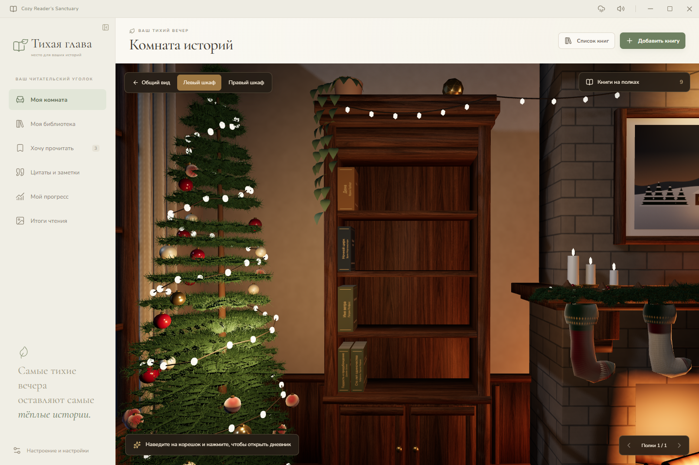
  
</p>

- **Настоящие книги на полках**: книги из вашей библиотеки автоматически расставляются по шкафам с учётом их толщины, цвета переплёта и тиснения.
- **Интерактивное управление (Raycasting)**: наведение курсора плавно выдвигает книгу с полки, а клик сразу открывает её читательский дневник.
- **Переключение камер**: «Общий вид» всей комнаты, приближение к «Левому шкафу» и «Правому шкафу».
- **Спящий кот у огня**: детальная 3D-модель полосатого кота, свернувшегося на коврике перед камином. Он плавно дышит во сне, реагирует шевелением ушка при наведении и сладко мурчит при клике.
- **Текстуры натурального дерева (PBR)**: в настройках можно выбрать материал книжных полок — **тёплый орех (Walnut)**, **светлый дуб (Oak)** или **красное дерево (Mahogany)** с физически корректным рельефом и рисунком волокон.
- **Настройка графики**: регулировка качества рендера, мягкие тени, выключение гирлянд и режим снижения анимаций (Reduced Motion).

---

### 2. 📚 Библиотека и книжные полки

Классический каталог книг с поддержкой двух режимов просмотра:

<p align="center">
  
</p>

- **Два вида библиотеки**:
  - **«Все книги»** — просторная сетка карточек с обложками, авторами, рейтингом и быстрыми действиями.
  - **«Книжные полки»** — деревянные полочки с корешками книг и перелистыванием страниц шкафа.
- **Умный поиск**: находит книги по названию и автору, устойчив к опечаткам и регистру, корректно сопоставляет буквы «е» и «ё».
- **Поиск в Open Library**: автоматический поиск изданий и загрузка оригинальных обложек из сети (сохраняются в локальное хранилище приложения).
- **Свои обложки и стилизация переплёта**: выбор палитры переплёта, золотое тиснение названия на корешке и загрузка собственных изображений с диска.
- **Список желаний («Хочу прочитать»)**: отдельный раздел для книг, которые только ждут своего часа.

<p align="center">
  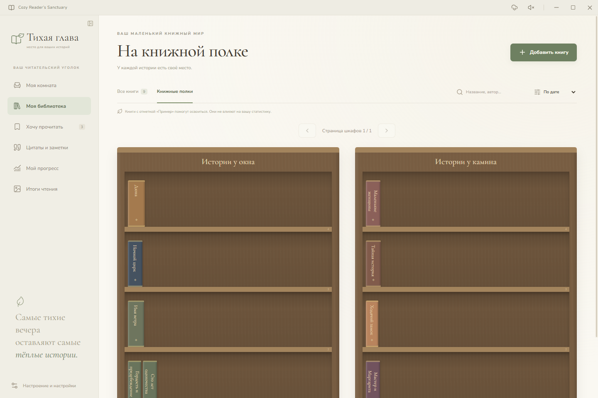
  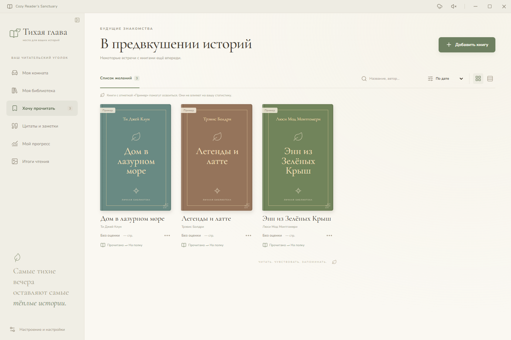
</p>

---

### 3. ✂️ Двухстраничный читательский дневник и скрапбукинг

Вдохновлён настоящими скрапбуками и арт-буками: полноценный разворот книги, на котором можно вести записи, рисовать и составлять памятные коллажи.

<p align="center">
  
</p>

<p align="center">
  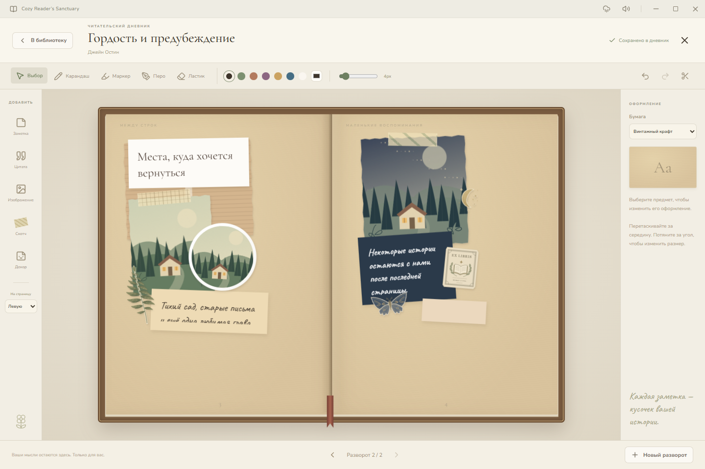
  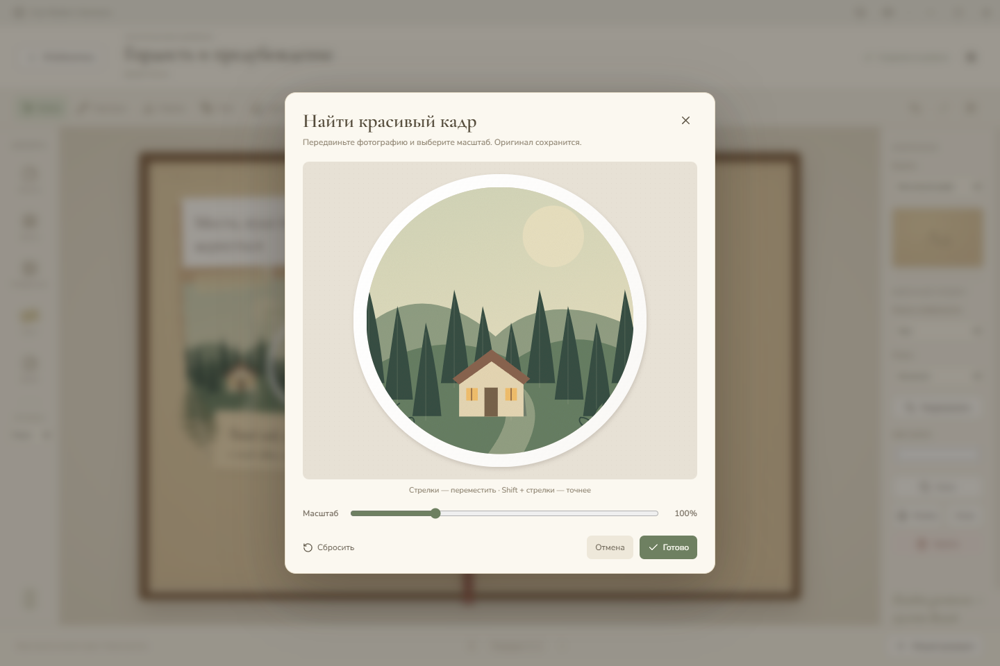
</p>

- **4 стиля бумаги**:
  - Точечная сетка (_Dot Grid_) — для аккуратных схем и заметок;
  - Линованная кремовая (_Lined Cream_) — классическая тетрадная страница;
  - Винтажный крафт (_Vintage Kraft_) — тёплая крафтовая бумага;
  - Чистый лист (_Blank_) — простор для рисунков.
- **Инструменты рисования**:
  - Карандаш с естественной текстурой грифеля;
  - Полупрозрачный маркер для выделения строк;
  - Перо для каллиграфических линий;
  - Ластик, аккуратно стирающий штрихи без повреждения бумаги и наклеенных предметов.
- **Элементы коллажа (Scrapbooking)**:
  - 📝 **Крафтовые записки**: редактируемый текст, палитра бумаги и выбор шрифтов (_Caveat, Cormorant Garamond, Nunito, Marck Script_);
  - 💬 **Цитатные блоки**: выделенные цитаты из произведения;
  - 📷 **Полароиды и фотографии**: снимки с подписями, выбор формы (прямоугольник, круг, овал, рваные края) и рамки (полароид, бумажная, без рамки);
  - 🔍 **Умное кадрирование**: инструмент «Найти красивый кадр» с настройкой масштаба и свободным перетаскиванием окна обрезки;
  - 🩹 **Декоративный скотч (Washi Tape)**: бумажные полоски скотча с узорами (клетка, ботаника, звёзды);
  - 🌿 **Векторные наклейки и декор**: ботанические иллюстрации (папоротник, олива, цветы), ночное небо (луна, звёздная книга, мотылёк), штампы и экслибрисы;
  - 📂 **Импорт собственных наклеек**: поддержка любых PNG с прозрачным фоном, сохраняющих свой силуэт.
- **Удобство работы**: свободное перемещение, изменение размеров, вращение на любой угол, управление слоями (z-index), быстрое дублирование предметов, история действий `Ctrl+Z` / `Ctrl+Y` и мгновенное автосохранение через 500 мс.

---

### 4. 💬 Цитаты и заметки («Между строк»)

Специальный раздел собирает все сохранённые мысли, яркие фрагменты и инсайты из ваших прочитанных книг в единую галерею.

<p align="center">
  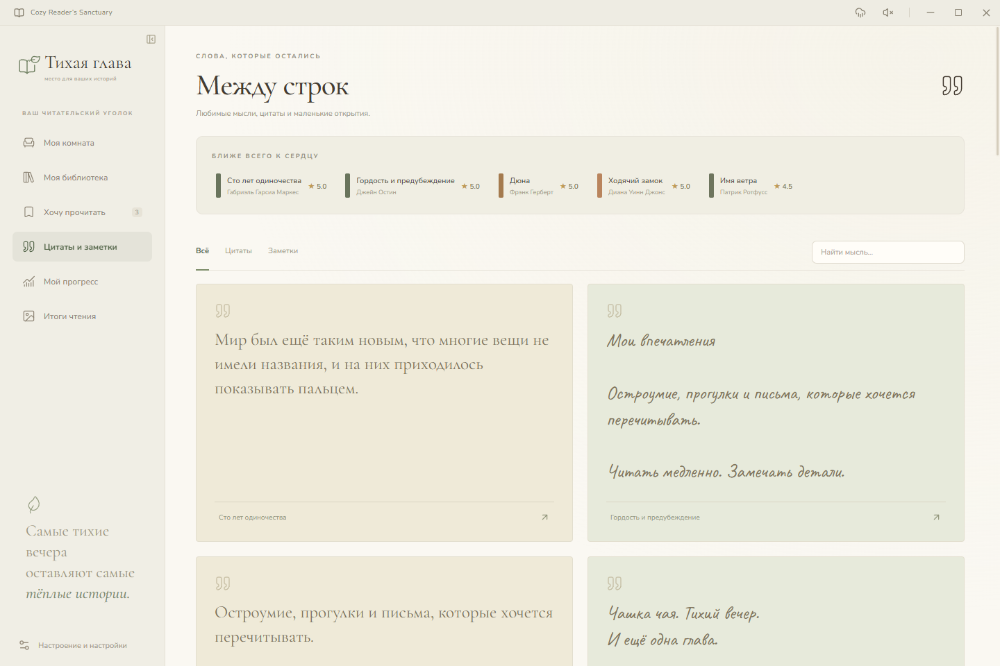
</p>

- Карточки с рукописным шрифтом и цитатным оформлением.
- Лента «Ближе всего к сердцу» с вашими любимыми книгами высшего рейтинга.
- Мгновенная фильтрация по типу (всё / только цитаты / только заметки) и поиск по тексту.

---

### 5. 📈 Читательский прогресс («Маленькие шаги, большие миры»)

Мягкий и спокойный подход к чтению без давления:

<p align="center">
  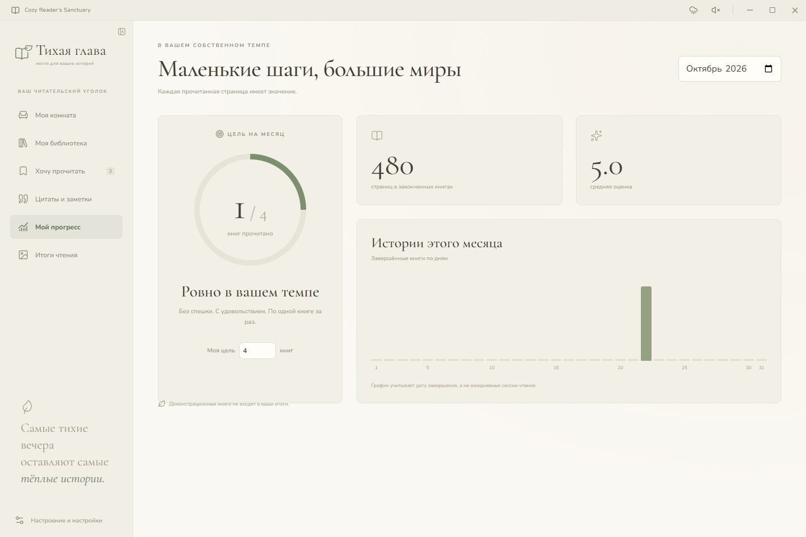
</p>

- **Кольцо цели на месяц**: настройте комфортную цель (например, 2 или 4 книги) и наблюдайте за заполнением кольца в собственном темпе.
- **Суммарный объём**: точный подсчёт страниц в завершённых книгах и средний балл оценок.
- **График завершённых книг**: наглядная гистограмма по дням выбранного месяца.

---

### 6. 🖼 Итоги чтения (Story Cards)

Генератор стильных итоговых карточек месяца или года, оптимизированных под экраны смартфонов:

<p align="center">
  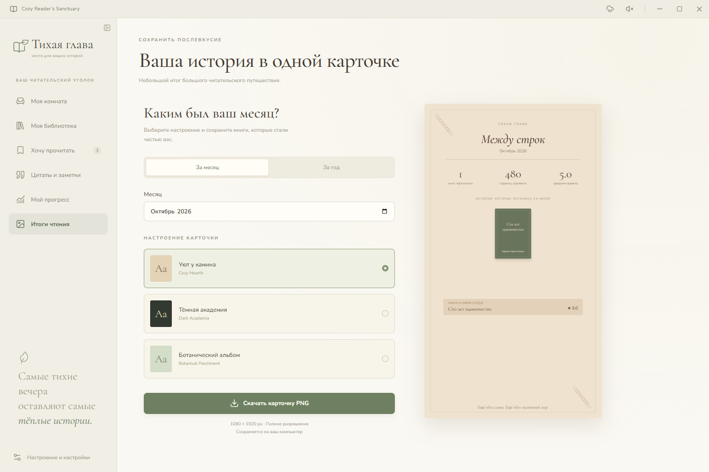
</p>

- **Три авторских оформления**:
  - _«Уют у камина» (Cozy Hearth)_ — тёплые оливковые и каминные тона;
  - _«Тёмная академия» (Dark Academia)_ — глубокие тёмные оттенки и винтажная строгость;
  - _«Ботанический альбом» (Botanical Parchment)_ — светлый пергамент с зелёными акцентами.
- **Экспорт в один клик**: сохранение полноразмерной PNG-карточки 1080×1920 без потери качества.

---

### 7. 🌧 Звуки уюта, темы и настройки атмосферы

Встроенный звуковой движок воспроизводит реалистичные стерео-аудиозаписи, а настройки позволяют адаптировать визуальный стиль и материалы:

<p align="center">
  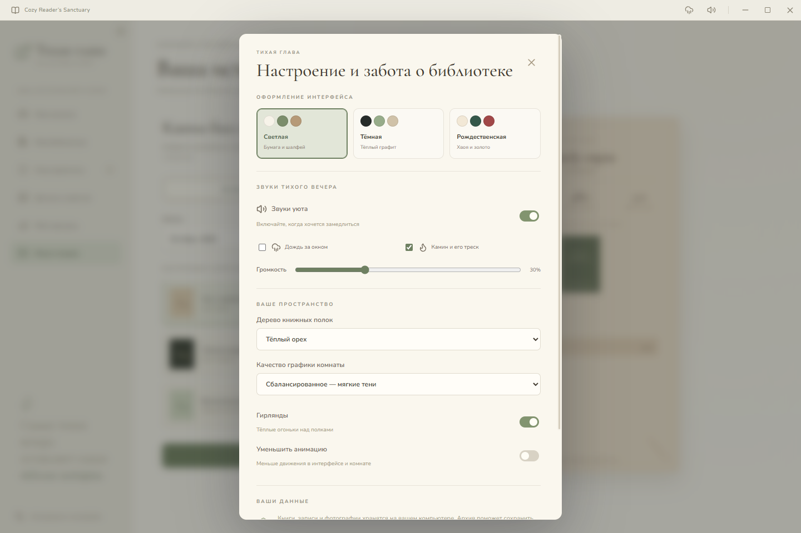
  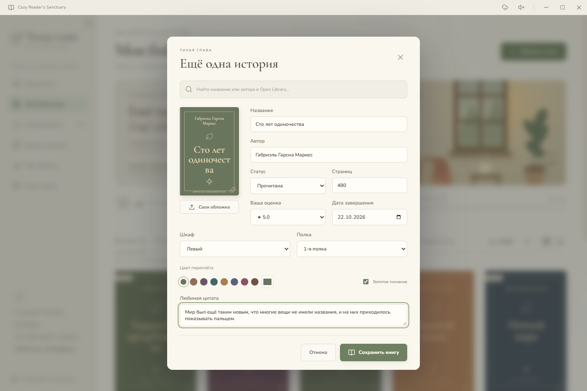
</p>

- **3 темы оформления интерфейса**:
  - _«Тёплый крем» (Cozy Cream)_ — светлая классическая палитра с мягким пергаментным фоном;
  - _«Тёмная академия» (Dark Academia)_ — глубокие тёмные тона старинной библиотеки для вечернего чтения;
  - _«Рождественская хвоя» (Christmas Spruce & Berry)_ — глубокий изумрудный оттенок хвои и ягодные акценты.
- **Дождь за окном**: мерный, успокаивающий звук капель по стеклу.
- **Камин**: мягкий треск горящих дров.
- **Ретро-радио на столике**: мягкая lo-fi аранжировка _Jingle Bells_. Клик по радио на столике в 3D-комнате или переключатель в меню мгновенно ставит музыку на паузу или возобновляет воспроизведение с того же места.
- **Ползунок громкости**: плавная настройка общего звукового фона.
- **Резервные копии**: экспорт и импорт всей библиотеки вместе со всеми медиафайлами в единый `.zip`-архив.

<p align="center">
  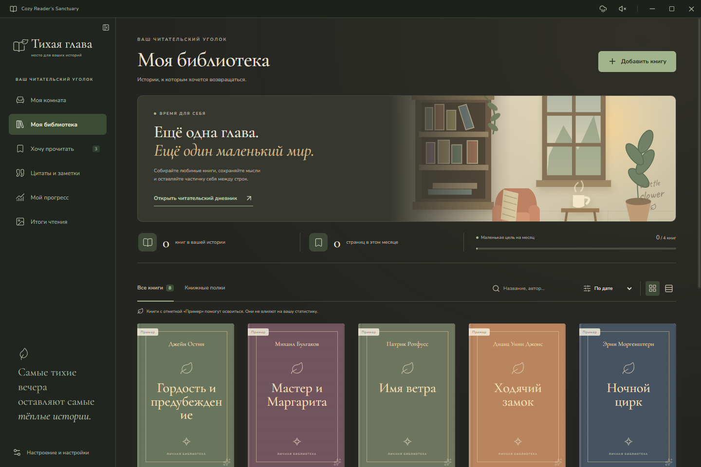
  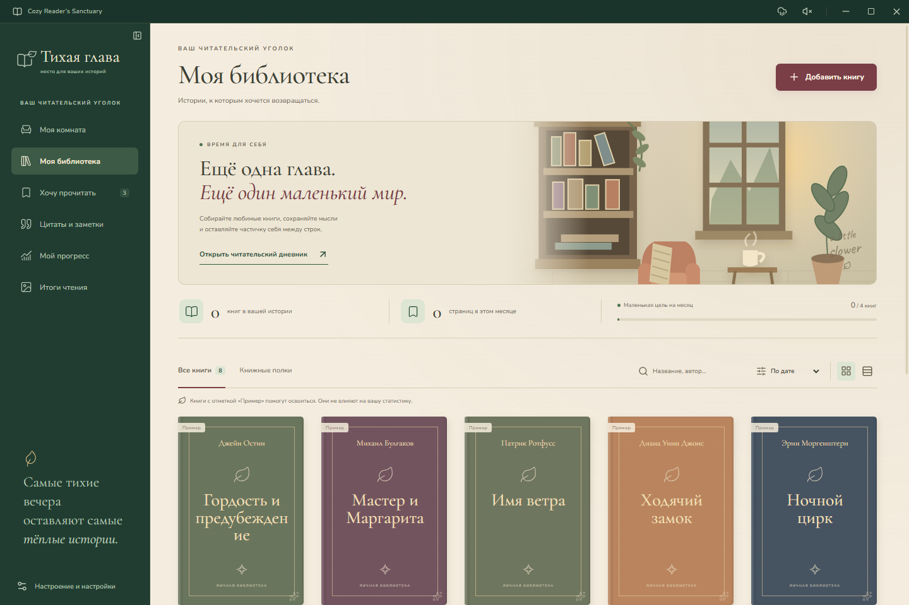
</p>

---

## 🖼 Галерея интерфейса

|        3D-комната (Общий вид)         |         Книжный шкаф (3D-камера)         |
| :-----------------------------------: | :--------------------------------------: |
|  |  |

|           Камин и спящий кот (3D-деталь)           |         Настройки атмосферы и звука         |
| :------------------------------------------------: | :-----------------------------------------: |
|  |  |

|           Тёмная тема (Dark Academia)           |            Рождественская тема (Christmas Spruce)            |
| :---------------------------------------------: | :----------------------------------------------------------: |
|  |  |

|       Главная библиотека (Все книги)        |    Деревянные книжные полки (2D)     |
| :-----------------------------------------: | :----------------------------------: |
|  |  |

|      Дневник: классический разворот      |       Скрапбукинг: арт-коллажи и наклейки       |
| :--------------------------------------: | :---------------------------------------------: |
|  |  |

|             Кадрирование и форма фото              |          Добавление книги и Open Library           |
| :------------------------------------------------: | :------------------------------------------------: |
|  |  |

|    Цитаты и заметки («Между строк»)    |        Список желаний («Хочу прочитать»)         |
| :------------------------------------: | :----------------------------------------------: |
|  |  |

|        Читательский прогресс и цели        | Итоги чтения (Story Cards 1080×1920) |
| :----------------------------------------: | :----------------------------------: |
|  |  |

---

## ⌨️ Горячие клавиши

| Сочетание клавиш                | Действие                                                |
| :------------------------------ | :------------------------------------------------------ |
| `Ctrl + Z`                      | Отменить последнее действие в дневнике                  |
| `Ctrl + Y` / `Ctrl + Shift + Z` | Повторить отменённое действие                           |
| `Ctrl + S`                      | Принудительное мгновенное сохранение дневника           |
| `Delete` / `Backspace`          | Удалить выделенный элемент коллажа                      |
| `Escape`                        | Снять выделение с предмета или закрыть диалог / дневник |

---

## 💾 Данные и безопасность

Приложение следует принципу **Local-First**: ваши мысли, личные записи и фотографии принадлежат только вам.

- **Каталог данных**: `%APPDATA%\Cozy Reader's Sanctuary`
  - `sanctuary.sqlite` — локальная база SQLite со всеми книгами, дневниками и цитатами;
  - `sanctuary.sqlite.bak` — автоматический снимок базы перед каждым сеансом;
  - `media/` — импортированные обложки и фотоснимки.
- **Резервные копии в один клик**: в окне «Настроения и настройки» можно сохранить всю библиотеку вместе со всеми изображениями в единый `.zip`-архив или восстановить библиотеку на новом компьютере.
- **Песочница Electron**: контекстная изоляция (`contextIsolation: true`), отключённая интеграция Node в рендерере (`nodeIntegration: false`), проверка протоколов и изоляция файловой системы.

---

## 🚀 Установка и запуск

### Скачать готовый EXE (для обычных пользователей)

Для запуска приложения не требуются Node.js, Git или Blender:

1. Перейдите во вкладку [Releases](../../releases) или скачайте артефакт последней успешной сборки в [GitHub Actions](../../actions/workflows/windows-ci.yml).
2. Запустите портативный файл `Sanctuary-1.3.7-portable.exe` (или установщик `Sanctuary-Setup-1.3.7-x64.exe`).
3. Приложение сразу готово к работе и создаст уютную стартовую библиотеку с примерами.

### Сборка из исходников (для разработчиков)

**Требования**: Windows 10/11 x64, Node.js 20+ (рекомендуется Node 24), npm.

```powershell
# 1. Клонирование репозитория
git clone https://github.com/GL1NoMe5/OwnLibrary.git
cd OwnLibrary

# 2. Установка зависимостей
npm ci

# 3. Инициализация Electron binary (если требуется)
node node_modules/electron/install.js

# 4. Запуск приложения в режиме разработки
npm run dev
```

### Сборка дистрибутива Windows

```powershell
# Проверка типов TypeScript
npm run typecheck

# Запуск модульных тестов Vitest
npm test

# Сборка пакетов
npm run build

# Сквозные тесты Playwright (E2E)
npm run test:e2e

# Генерация EXE инсталлятора и Portable версии в каталог dist/
npm run build:win
```

---

## 🛠 Архитектура и стек технологий

- **Десктопная платформа**: [Electron](https://www.electronjs.org/) 45, [electron-vite](https://electron-vite.org/) 6
- **Фронтенд**: [React](https://react.dev/) 19, [TypeScript](https://www.typescriptlang.org/) 7, [Zustand](https://github.com/pmndrs/zustand) 5
- **3D-графика (WebGL)**: [Three.js](https://threejs.org/) 0.186, PBR-шейдеры, оптимизированные GLTF-модели комнат и мебели
- **База данных**: [sql.js](https://sql.js.org/) (SQLite, скомпилированный в WebAssembly), схема со строгой валидацией через [Zod](https://zod.dev/)
- **Иконки и типографика**: [Lucide React](https://lucide.dev/), шрифты _Nunito_, _Cormorant Garamond_, _Caveat_, _Marck Script_
- **Тестирование**: [Vitest](https://vitest.dev/) (unit-тесты базы, поиска, размещения книг на полках), [Playwright](https://playwright.dev/) (e2e-тесты Electron, WebGL-холста, скриншотов и сохранения)

---

## 📜 Дополнительные материалы

- [О дизайне и оптимизации 3D-комнаты (docs/ROOM.md)](docs/ROOM.md) — разбор 3D-сцены, материалов и производительности на GPU.
- [План развития (docs/ROADMAP.md)](docs/ROADMAP.md) — будущие идеи, новые темы комнат и функции.
- [Протокол верификации (docs/VERIFICATION.md)](docs/VERIFICATION.md) — детализация тестового покрытия и архитектурных инвариантов.
- [Уведомления о сторонних компонентах (THIRD_PARTY_NOTICES.md)](THIRD_PARTY_NOTICES.md) — лицензии библиотек, моделей и шрифтов.

---

<div align="center">

_«Тихая глава» — место, где книги находят свой дом, а мысли остаются между строк._ 🌿📖✨

</div>
